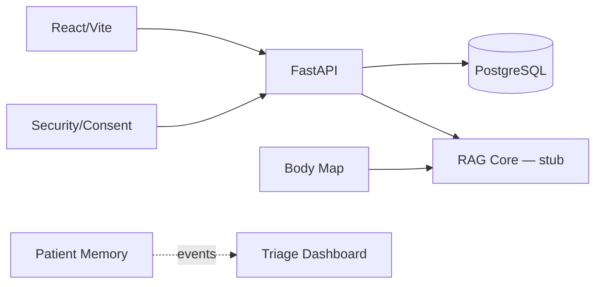
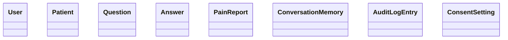
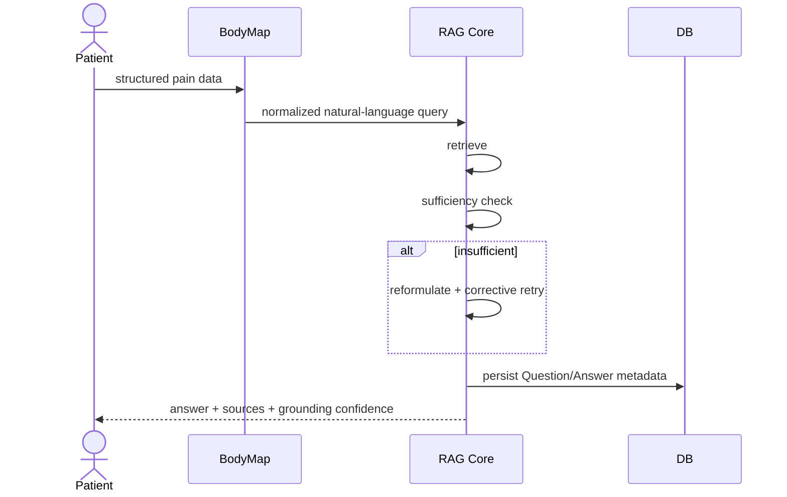

# Software Design Description (SDD) — MedAssist

> **Status:** Incremental template. The runtime API contract is generated by FastAPI Swagger at `/docs` and OpenAPI at `/openapi.json`.

## 1. Architecture Overview

_TODO: describe monorepo, layered/domain organization, frontend/backend boundaries, persistence, and trust boundaries._

### 1.1 High-Level Component View

## 2. Class Diagram

> **PLACEHOLDER:** Replace with reviewed class diagram as implementation matures.

## 3. Sequence Diagram — Core Q&A Flow

> **PLACEHOLDER:** Refine in Phase 2 once feature contracts are stable.

## 4. Design Patterns Used

| Subsystem | Pattern | Scaffold | Justification |
|---|---|---|---|
| RAG Core | Strategy | `backend/rag_core/patterns.py` | Retrieval, sufficiency judging, and reformulation can change independently and be compared in evaluation. |
| Body Map | Adapter | `backend/body_map/patterns.py` | Keeps UI-specific structured pain input separate from the RAG text-query contract. |
| Patient Memory | Repository | `backend/patient_memory/patterns.py` | Decouples conversation-memory behavior from SQLAlchemy/storage decisions. |
| Patient Memory → Dashboard | Observer | publisher + `backend/dashboard/patterns.py` | Dashboard can react to escalation/reference events without direct coupling to memory internals. |
| Security | Chain of Responsibility | `backend/security/patterns.py` | Allows ordered RBAC/rate-limit/audit checks to be composed and tested separately. |
| Evaluation | Strategy | `backend/eval/patterns.py` | Accuracy/faithfulness/other metrics remain pluggable across plain vs agentic RAG runs. |

## 5. Database Schema

Canonical persistence declarations: `backend/models.py`. Migration baseline: `backend/alembic/versions/0001_initial.py`.

| Entity | Key relationships / notes |
|---|---|
| User | role = patient/doctor/admin; core shape contains no credential material |
| Auth credential | separate `user_credentials` table stores password hash outside the core User contract |
| Patient | one-to-one user link; flexible profile JSON |
| Question | belongs to patient; optional doctor; pending/answered |
| Answer | one per question; citation list + grounding confidence |
| PainReport | structured body region/type/severity/duration |
| ConversationMemory | patient + doctor + message list |
| AuditLogEntry | actor/action/target + prev_hash/hash contract |
| ConsentSetting | patient/category/shared toggle |

_TODO: insert ER diagram and final cardinalities/index rationale._

## 6. API Contract Summary

**Source of truth:** FastAPI Swagger UI at `http://localhost:8000/docs` after starting the backend. Machine-readable OpenAPI: `/openapi.json`.

Current route groups:

- `/api/auth/*` — implemented scaffold auth
- `/api/rag/*` — Mostafa stub
- `/api/body-map/*` — Adham stub
- `/api/patient-memory/*` — Omar stub
- `/api/security/*` — Ziad stub
- `/api/dashboard/*` — Nour stub

_TODO: for Phase 2, export/version OpenAPI and summarize status codes, auth roles, and major request/response schemas._

## 7. Deployment View

_TODO: update from `/deploy` once target registry/host is selected._
