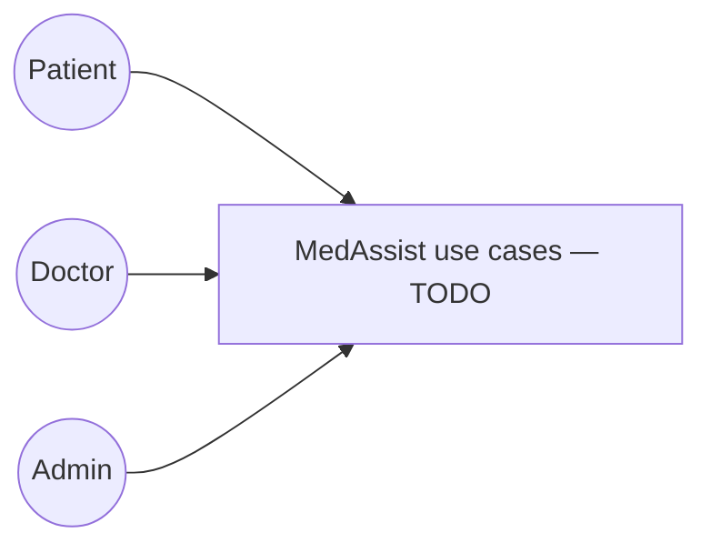

# Software Requirements Specification (SRS) — MedAssist

> **Status:** Incremental coursework template. Keep requirement IDs stable once assigned so tests can trace to them.

## 1. Introduction

### 1.1 Purpose
_TODO_

### 1.2 Scope
_TODO_

### 1.3 Definitions, Acronyms, and Abbreviations
_TODO_

### 1.4 References
_TODO: course material / Sommerville edition / project references._

## 2. Overall Description

### 2.1 Product Perspective
_TODO_

### 2.2 User Classes
- Patient
- Doctor
- Administrator

### 2.3 Operating Environment
_TODO_

### 2.4 Assumptions and Dependencies
_TODO_

## 3. Functional Requirements — by Role

### 3.1 Patient
| ID | Requirement | Priority | Acceptance note |
|---|---|---|---|
| FR-P-001 | _TODO_ | _TODO_ | _TODO_ |

### 3.2 Doctor
| ID | Requirement | Priority | Acceptance note |
|---|---|---|---|
| FR-D-001 | _TODO_ | _TODO_ | _TODO_ |

### 3.3 Administrator
| ID | Requirement | Priority | Acceptance note |
|---|---|---|---|
| FR-A-001 | _TODO_ | _TODO_ | _TODO_ |

## 4. Non-Functional Requirements

| ID | Quality attribute | Measurable requirement | Verification method |
|---|---|---|---|
| NFR-001 | Security | _TODO_ | _TODO_ |
| NFR-002 | Performance | _TODO_ | _TODO_ |
| NFR-003 | Reliability | _TODO_ | _TODO_ |
| NFR-004 | Usability | _TODO_ | _TODO_ |
| NFR-005 | Privacy | _TODO_ | _TODO_ |

## 5. Sommerville: User Requirements vs System Requirements

### 5.1 User Requirements
_High-level natural-language services/constraints understandable to users/customers._

- UR-001 — _TODO_

### 5.2 System Requirements
_Detailed, precise functions, interfaces, constraints, and measurable behavior derived from user requirements._

- SR-001 — _TODO; trace to UR-001._

## 6. Use Case Diagram

> **PLACEHOLDER:** Insert/export the approved use-case diagram here.

## 7. Constraints

- University coursework timeline: Phase 1 Week 6; Phase 2 Week 15.
- Selected stack: FastAPI, React/Vite, PostgreSQL, SQLAlchemy/Alembic.
- _TODO: deployment, data, medical-safety, privacy, budget, hosting constraints._

## 8. Traceability Notes

_TODO: map UR → SR/FR → API/use case → validation tests._
